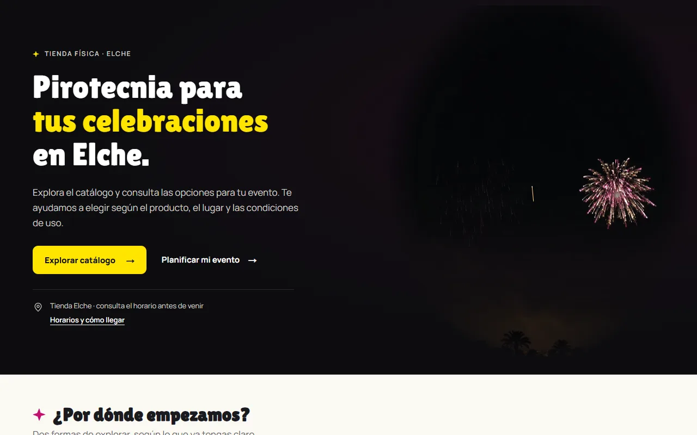

# Piroboom 🎆: The website of a fireworks shop in Elche

[](https://github.com/rechedev9/piroelche/actions/workflows/ci.yml)
[](https://pirotecniaelche.es)
[](package.json)
[](package.json)
[](tsconfig.json)

Piroboom is the complete website of Pirotecnia Elche, a fireworks shop in Elche, Spain, live at [pirotecniaelche.es](https://pirotecniaelche.es). Visitors browse the 2026 catalogue online, ask about a product or plan an event (weddings, gender reveals, celebrations), and find the store, its kiosks, opening hours and phone number. The shop gets enquiries that are recorded once, even when a visitor retries, and a catalogue that stays online as a page-by-page reader instead of a heavy download. Luis Reche designed, built and deployed it end to end for the company. The site is in Spanish.



## Quick start

Requires **Node 24+** and **pnpm 11.22.0**. From the project root, in Bash:

```bash
pnpm install --frozen-lockfile
LOCALAPPDATA="${LOCALAPPDATA:-$PWD/.local}" pnpm demo
```

Open **http://127.0.0.1:3000**. The demo uses labelled fixtures and a real local HTTP receiver on port **4010**, with synthetic submissions stored in private SQLite. The command defaults its storage base to the ignored `.local/` directory. No business messages are sent. `Ctrl+C` stops both services.

To work with public content instead, use `pnpm dev`. To preview a production build:

```bash
pnpm build
pnpm start --port 3001
```

Open **http://127.0.0.1:3001**. Public content excludes demo products and cases. The default configuration keeps indexing and public form submissions disabled and shows a telephone alternative. Optional server settings live in [.env.example](.env.example); the demo needs no env file.

## The catalogue reader

The shop's catalogue used to be a single 82 MB PDF. It is now a 16-page reader at `/catalogo-pdf/`:

- Page images load one at a time, so reading never downloads the PDF. The PDF stays available as an optional download, and the old WordPress PDF address redirects to it.
- Search runs locally over the text of every page and ignores accents. Zoom goes from 1x to 3x.
- Page links, the jump-to-page form and the readable text of each page work without JavaScript.
- Product families (fireworks, coloured smoke, cold fire, firecrackers and others) link to the matching pages.

## Enquiries

Three enquiry types share one form: a product question, an event request (wedding, gender reveal, birthday, larger celebration or other, with date or "to be defined", place and budget) and a store visit or general question. The server forwards each one to a receiver the shop configures.

- **Drafts:** what a visitor types is kept in the browser tab for 30 minutes, survives a reload, and is kept after a failed send. Changing the reason keeps contact details and drops the old reason's fields.
- **Retries:** each submission carries an idempotency key, so a double click, a lost response or a reload recovers the same record instead of creating a second one.
- **Receipts:** success is shown only when the receiver returns a valid receipt, and the visitor sees its reference. Without a receiver the page shows the phone number and never claims delivery.
- **Abuse limits:** origin check, 16 KiB body limit, honeypot field, rate limiting, and rejection of references that are not published.

The receiver is configured with the `LEADS_*` variables in [.env.example](.env.example). Remote mode requires an HTTPS receiver URL, a server-only token of at least 32 characters and an origin allow-list.

## Content editing

Editable content (store, hours, kiosks, product families, event occasions, legal texts) lives in [content/site.json](content/site.json) and is validated by [content-schema.ts](src/lib/content-schema.ts). Edits need a rebuild and a restart of the production preview; check them with `pnpm validate:content`. Example inventory stays in [fixtures/](fixtures/).

The catalogue importer is prepared for a private Google Drive folder. It downloads and validates `catalogo.pdf`, then generates its cover, page images, searchable text and navigation together. Synchronization stays disabled until Drive and hosting are configured, and no daily job is included. Setup and the editor's instructions are in [docs/catalogue-sync.md](docs/catalogue-sync.md).

## Legal and safety constraints

- **No online sales.** Spanish law forbids shipping fireworks, so the site has no cart or payment. Visitors enquire by form, phone or email and buy in store.
- **Nothing is invented.** The site publishes no prices, stock or case studies that the shop has not supplied, and demo fixtures can never be published as business facts.
- **Indexing is gated.** Search engines see `noindex` unless `PIROBOOM_PUBLIC_SITE=1`, and publishing also requires the three legal texts to be confirmed. See [docs/seo.md](docs/seo.md).
- **Visitors are not tracked.** The public pages are checked for no cookies, trackers or third-party requests on first visit.

## Checks and tests

```bash
pnpm lint
pnpm typecheck
pnpm test
pnpm build
pnpm exec playwright install chromium firefox webkit
LOCALAPPDATA="${LOCALAPPDATA:-$PWD/.local}" pnpm test:e2e
```

There are 68 unit and integration tests in [tests/](tests/), including a real HTTP receiver, retries and restarts. There are 38 browser tests in [tests/e2e/](tests/e2e/), run in Chromium, Firefox and WebKit. They cover the catalogue with and without JavaScript, search and zoom, forms and retries, publication rules and axe accessibility checks. Both numbers are counted from the test files.

[Playwright](playwright.config.ts) starts fresh demo and public servers on **3000** and **3001**, using a separate `.next-e2e-demo` directory for the demo. Reusing servers requires `E2E_REUSE_SERVERS=1`; both must run the current code and the demo must have its receiver configured. Reports go to `playwright-report/` and `evidence/playwright-results.json`. If a development server already occupies those ports, run an isolated check:

```bash
LOCALAPPDATA="$PWD/.local/e2e" E2E_DEMO_PORT=3100 E2E_PUBLIC_PORT=3102 \
  REVIEW_RECEIVER_PORT=4110 E2E_REPORT_DIR=.local/e2e-report pnpm test:e2e
```

Measure the initial HTML and JavaScript of a running production build with `pnpm exec tsx scripts/measure-delivery.ts http://127.0.0.1:3001`. An optional second argument writes the JSON report to a file.

[GitHub Actions](https://github.com/rechedev9/piroelche/actions/workflows/ci.yml) runs the quality lane on Ubuntu (dependency advisories, types, lint, unit tests and a production build) on pushes to `main`, nightly and on demand, and lints the workflows with a pinned actionlint when they change. Browser tests are not part of CI: run `pnpm test:e2e` locally. The configuration is in [.github/workflows](.github/workflows).

## Deployment

The site runs as a Docker container on the client's VPS. [deploy/Dockerfile](deploy/Dockerfile) builds a Node 24 standalone image and [deploy/compose.yaml](deploy/compose.yaml) runs it with a read-only filesystem, all capabilities dropped and a 512 MB memory limit. The container listens only on `127.0.0.1:8093`, and a reverse proxy on the host terminates HTTPS (a Caddy example is in [deploy/Caddyfile.snippet](deploy/Caddyfile.snippet)).

Defaults are conservative: indexing off, no promotion popup, form receiver disabled. The canonical origin and the indexing flag are baked in at build time, so changing them means rebuilding the image. Publishing is manual and pushing to GitHub does not deploy. [deploy/README.md](deploy/README.md) (in Spanish) covers server preparation, configuration, building and testing a candidate image, and rollback.

## Documentation

| File | Contents |
| --- | --- |
| [docs/architecture.md](docs/architecture.md) | Module boundaries, data lifetime, enquiry flow, delivery measurements (Spanish) |
| [docs/seo.md](docs/seo.md) | Indexing gate, metadata, structured data, AI-crawler files |
| [docs/catalogue-sync.md](docs/catalogue-sync.md) | Updating the catalogue from Google Drive (Spanish) |
| [deploy/README.md](deploy/README.md) | Docker deployment, verification and rollback (Spanish) |
| [docs/hero-fireworks.md](docs/hero-fireworks.md) | Origin of the home page animation assets (Spanish) |
| [docs/favicon.md](docs/favicon.md) | Favicon source and regeneration (Spanish) |
| [docs/licenses/](docs/licenses/) | Font and component licenses |
| [AGENTS.md](AGENTS.md) | Rules for coding agents working in this repository |
| [evidence/](evidence/) | Source manifests and historical verification artifacts |
